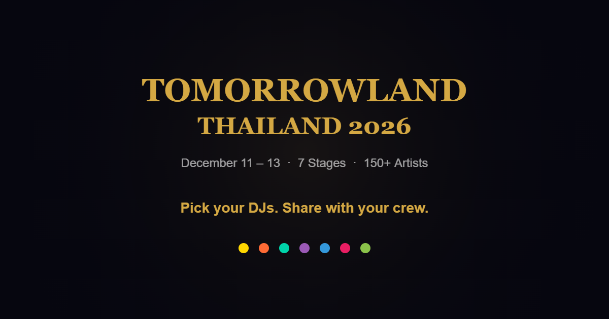

<p align="center">
  
</p>

<h1 align="center">Tomorrowland Thailand 2026 — Lineup Picker</h1>

<p align="center">
  Pick your DJs. Share with your crew.<br>
  <a href="https://jwn0-0.github.io/tml-lineup-picker"><strong>Open App</strong></a>
</p>

---

## What is this?

Going to **Tomorrowland Thailand (Dec 11-13, 2026)** with friends? Everyone wants to see different DJs. This app lets each person pick their favorites and share — so you can coordinate who's going where.

## Features

- **3 Days, 7 Stages, 150+ Artists** — Full lineup with accurate set times
- **Pick & Select** — Tap any DJ to mark them as your pick (gold highlight)
- **Share with Friends** — Copy a link with your selections encoded; friends see your picks in cyan
- **Conflict Detection** — Overlapping sets get a red warning so you know when you have to choose
- **DJ Photos** — Artist images for easy recognition
- **Save as Image** — Export your picks as a PNG to share on group chats
- **My Picks Summary** — See all your selected DJs across all days in one view
- **Search** — Quickly find any DJ by name
- **Mobile Optimized** — Pinch to zoom, swipe to scroll, touch to select

## Stages

| Color | Stage |
|-------|-------|
| :yellow_circle: | Mainstage |
| :orange_circle: | Freedom by Bud |
| :green_circle: | Core |
| :purple_circle: | Crystal Garden by Anker |
| :blue_circle: | Codex |
| :heartpulse: | Papillon |
| :deciduous_tree: | Moosebar |

## How to Use

1. Open the [app](https://jwn0-0.github.io/tml-lineup-picker)
2. Browse by day (Fri / Sat / Sun) and stage
3. Tap DJs you want to see — they turn gold
4. Hit **Share** to copy your link
5. Send the link to your crew
6. They open it and see your picks in cyan, then make their own picks

## Tech

Single `index.html` file. No framework, no build step, no backend.

- Vanilla JS + CSS
- html2canvas for image export
- localStorage for persisting selections
- URL hash encoding for sharing

## Run Locally

Just open `index.html` in a browser. For image export to work properly:

```bash
npx http-server -p 8080 -o
```

Or double-click `start.bat`.

## License

MIT
